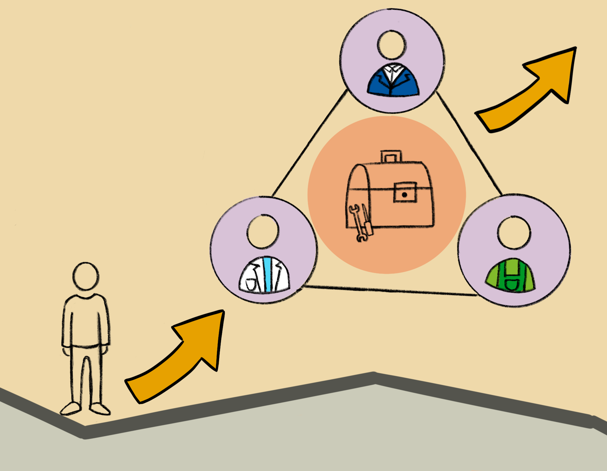
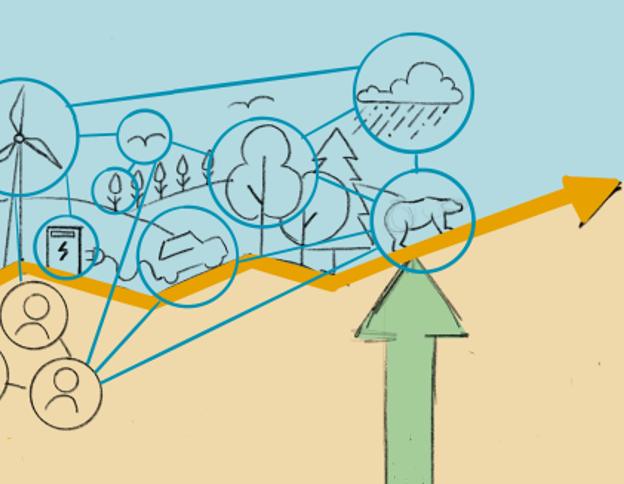
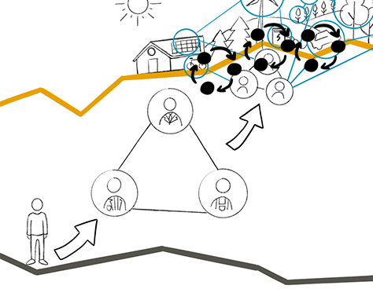
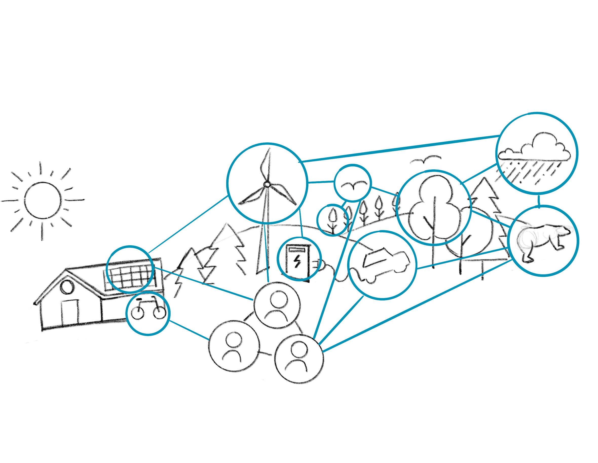
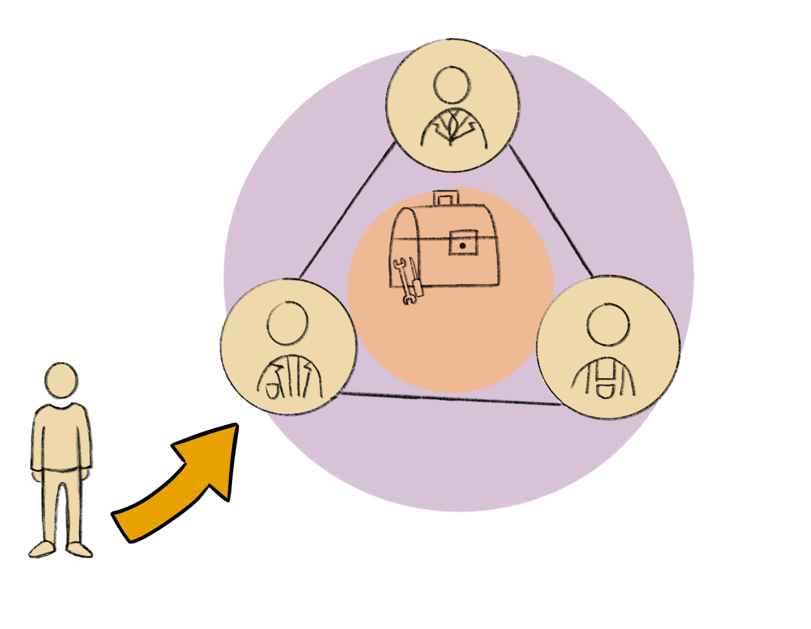
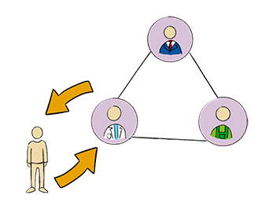
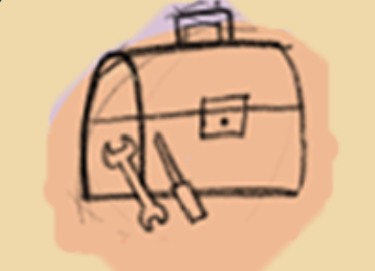
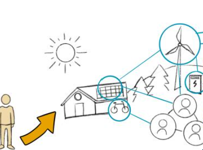

# The City As a Laboratory: Transformation and Learning
A Workbook

**Connect, explore, imagine and rethink your role in addressing sustainability challenges collectively.**

A joint effort between TU Berlin, Politecnico di Milano and TU Delft, co-funded by the European Union (Erasmus+, KA220-HED 2025–2028).

## Explore the workbook
::::{grid} 1 1 2 3

:::{card}
:link: ./module1.0_outline.md

**1. How can you contribute and use this Workbook?**
:::

:::{card}
:link: ./module2.0_outline.md

**2. Connect with and define the challenge**
:::

:::{card}
:link: ./module2.0_outline.md

**3. Design for values learning pathways**
:::

:::{card}

**4. Design for a more-than-human world**
:::

:::{card}

**5. Learning through cases and methods**
:::

:::{card}

**6 Get inspired by each other experiences**
:::

:::{card}

**Glossary of terms**
:::

:::{card}

**5. Learning Journey Portfolio**

:::

::::