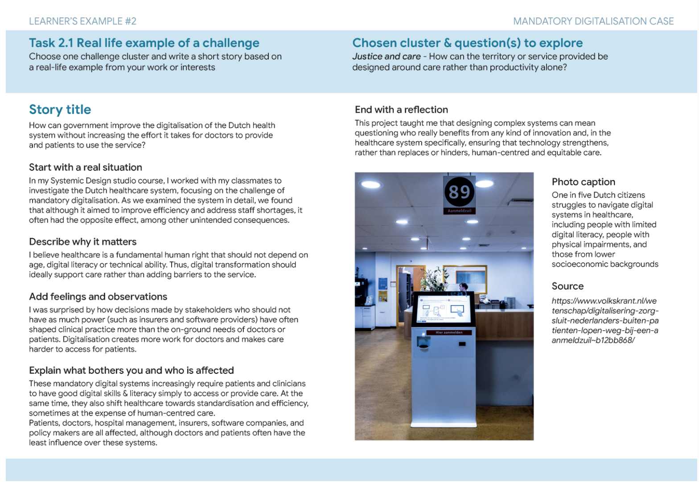

# 3.1 Values and the design of cross-boundary collaboration

In the previous chapter “Connect with and define the challenge”, you considered what draws you to a shared challenge, where its boundaries lie, who are its main stakeholder, and what role you could play. The way you defined the challenge already expresses values. If you framed urban heat as a public health issue, you might ask who is most exposed and how to protect them. If you framed it as a question of access to public space, you might ask who can use parks, streets, and squares on the hottest days. Each framing directs attention to particular experiences, brings different people into the conversation, and makes certain responses easier to imagine. Setting up a collaboration gives you a chance to revisit that framing with others.

<iframe width="560" height="315" src="https://www.youtube.com/embed/S6j6qpQerbM?si=aaESmNKEwQWs-nqw" title="YouTube video player" frameborder="0" allow="accelerometer; autoplay; clipboard-write; encrypted-media; gyroscope; picture-in-picture; web-share" referrerpolicy="strict-origin-when-cross-origin" allowfullscreen></iframe>

::::{dropdown} Video transcript
:icon: comment

Welcome to this module...

[Full transcript goes here]

::::

## Task 2.1 A challenge worth exploring: Your story behind it.

By Juliette-Cortes-Arevalo, Francesco Vergani & Valentina Faccoetti 

Choose a real-life challenge from the clusters listed below to explore how your personal experiences shape your connection to the challenge.

  <ul>
  <li>15 minutes own story.</li>
  <li>15 minutes to interview other actors.</li>
  </ul>

Analyse how your experiences shape your perspective on a real-world challenge and its stakeholders.

<ul>
    <li>A space to take notes and reflect.</li>
</ul>

  
Keywords

  

    Method category:
  Reconstruct & Intervene
  Reflective storytelling
  Challenge-based learning
  

  

    Inner Development Goal:
    Being - Self-awareness
  

  

    Change step:
    Connect and defining the problem  
  

This task builds on your current understanding of the challenge. Other perspectives may not yet be visible unless they are explored further, for example by using the same questions to engage with or interview other actors.

<ul><li><strong>Choose a challenge:</strong> Use the guiding questions of one challenge cluster to explore it in relation with your work or interests.</li>

::::{grid} 2
:::{card} Shared spaces and collective practices
**Who creates and governs these in the future?**

Shared spaces are increasingly shaped by tensions between shared resources and privatisation.

**Questions to explore**
- How can new shared spaces be created?
- What forms of governance can involve citizens?
:::

:::{card} Justice and care
**Who has access to wellbeing?**

Access to health, green space, mobility and safety varies.

**Questions to explore**
- How can territorial inequalities be reduced?
- How can overlooked needs become visible?
:::

:::{card} Vulnerability and climate adaptation:
**How can we live with a changing climate?**

Places, in for example, cities will face increasing exposure to extreme weather events, resource scarcity and biodiversity loss. Adaptation is not only a technical challenge but also requires new ways of inhabiting and relating to an environment.

**Questions to explore**
- How can one respond to extreme weather and new forms of vulnerability or exposure to harm or risk? 
- How can disrupted ecological relationships be restored?
- How can natural and built systems be better integrated?
- How can territories address the challenge without increasing inequalities? 
:::

:::{card} Memory and conflict:
**Whose stories shape  transformation?**

Regeneration is the process of improving and transforming parts of a place to make them stable locations to live and work. However, it often creates tensions between memories, identities, interests, and different visions of the future, where some stories are highlighted while others are overlooked or erased.

**Questions to explore**
- How can marginalised histories be recognised and valued?  
- How can conflicts between long-term residents and newcomers be addressed? 
- How can development avoid pushing aside people’s culture or stories? 
- How can conflict support transformation?
:::

:::{card} The right to transform:
**Who has the power to shape the future of a place?**

Urban transformation is often driven by a limited number of government and economic actors. Yet emerging forms of participation, activism and civic engagement are reshaping who has the power to envision, influence, and shape the future of cities.

**Questions to explore**
- Who is excluded from decisions about the future of a place?  
- How can participation be broadened and made more meaningful? 
- Which non-human actors should have a voice in decision-making? 
- What new forms of democracy could emerge?
:::
::::

<ul>
<li><strong>Start with your personal connection.</strong> Describe a moment where you noticed the challenge. Be specific (e.g. “on my daily
commute…” or “in my neighbourhood…”).</li>
<li><strong>Describe why it matters?</strong> Explain why this problem is important to you and what consequences does it have for whom.</li>
<li><strong>What does it bother you about this situation?</strong> Share what feels wrong, unfair, or unsustainable.</li>
<li><strong>What inspires you to act?</strong> Consider also what triggered your interest, positively.</li>
<li><strong>Who is mostly affected by this situation?</strong> Mention people, groups, or even the environment affected by this problem situation.</li>
<li><strong>What do you wish it could be different?</strong> Share your feelings and observations about the change you wish to see and why is not happening yet.</li>
<li><strong>What photos or visual helps to illustrate the situation?</strong> Acknowledge the source and copyrights as necessary.</li>
<li><strong>To conclude, formulate a problem statement following the below guidance:</strong>
"How can [choose an actor who has key resources or responsibilities to take action on the challenge right now and you wish to support]
address [define the chosen actor’s main objective]
without [define the main two unintended consequences this actor wants to avoid]</li>
</ul>

## Example

## Download worksheet
