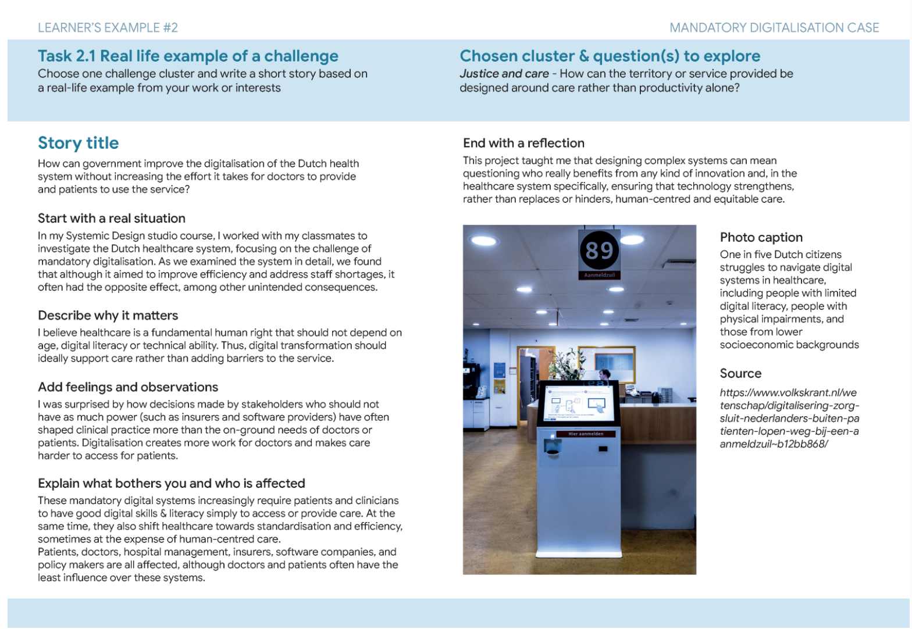

# Case: From biodiversity ambitions to local action in Zuid-Holland

Three neighborhood initiatives spanning the major urban areas of The Hague and Rotterdam and the smaller area of Rijswijk.

By Hanneke Bezemer, Axel Birnage, Amila In, Fatima-Zahra Abou Eddahab-Burke & Juliette Cortes-Arevalo

Under preparation

  
Is investing in biodiversity enough without investing in collaboration?

  
Municipalities can strengthen biodiversity by prioritising places where ecological and community values are aligned. However, lasting impact depends as much on supporting collaboration as on ecological interventions.

  
Across the neighborhood initiatives outlined in this case, participants valued diverse expertise but called for stronger evaluation, monitoring, and connections between initiatives to capture learning, broaden participation, and better support biodiversity improvements.

  
Keywords

  

    Cluster challenge:
  Vulnerability and climate adaptation  
  

  

    Method category:
    Reconstruct & Intervene
  

  

    Inner Development Goal:
    Relating - Connectedeness
  

  

    Change step:
    2. Join forces with intiatives that inspire you  
  

## Setting: Case location and documentation
Biodiversity in Dutch cities, particularly in the densely populated province of South Holland, is declining as urban development and infrastructure continue to fragment the green spaces needed for species to thrive. Yet healthy urban ecosystems can provide cultural benefits such as recreation and community cohesion while also supporting climate adaptation, depending on how they are designed and managed.

To restore and strengthen urban biodiversity, municipalities increasingly invest in neighborhood-based initiatives that engage residents, community organisations, and private actors in environmental stewardship. Such initiatives not only enhance local ecosystems but can also strengthen connections between people and nature. This case explores three initiatives (Figure Case 1-1) located in the major cities of The Hague and Rotterdam and the smaller city of Rijswijk. Their experiences offer inspiration and practical insights for anyone interested in supporting biodiversity through local collective action.

To better understand how to support neighborhood initiatives, the municipalities where these initiatives take place partnered with The Green Village, a field lab under the TU Delft’s Innovation & Impact Centre that connects practitioners and researchers working on climate adaptation innovations. Three bachelor’s theses from TU Delft’s Faculty of Technology, Policy and Management contributed to this effort by examining the strengths and tensions of municipal-community collaborations.

Drawing on policy documents, each thesis compared municipal ambitions with the experiences reported by four initiative participants interviewed between December 2025 and January 2026 to outline key lessons for similar initiatives.

## Ambitions - Organisational and project goals
Local governments in the Netherlands play a key role in achieving national biodiversity ambitions. Under the National Biodiversity Strategy and Action Plan 2025–2030, municipalities are expected to contribute to targets such as expanding urban green space, supporting biodiversity friendly design, enabling public participation, and restoring ecosystems. In South Holland, these ambitions are reflected in provincial and municipal policies, including strategies developed by The Hague, Rotterdam, and Rijswijk to strengthen biodiversity at the building, street, and neighborhood scales. For example, Rotterdam aims for all natural areas and ecological zones to meet the Basic Nature Quality standard by 2040, providing habitat conditions that can sustain representative native species. However, municipalities recognise that achieving biodiversity goals cannot rely solely on public land. As much urban space is privately owned, residents, community groups, and local organisations play a crucial role in creating and maintaining green spaces. Community-led initiatives therefore complement municipal efforts by contributing local knowledge, stewardship, and neighbourhood engagement.

At the same time, policy documents acknowledge that residents differ in their interests, capacities, and priorities, which can influence participation. Strengthening native biodiversity consequently requires collaboration among municipalities, professionals, community organisations, and residents, combining technical expertise and local knowledge to develop approaches tailored to the needs and opportunities of each neighbourhood. 

## Context - Organisational set up and resources
Municipalities in South Holland such the ones of this case description have introduced measures to support neighbourhood biodiversity initiatives. Residents can access funding for greening projects on private property, challenge municipal plans that may harm biodiversity, and benefit from planning guidelines requiring biodiversity-friendly features in new developments. In principle, these policies create opportunities to enhance urban nature without requiring additional land or major public investments. In practice, however, municipalities struggle to balance biodiversity ambitions with competing priorities. As recognised in Rotterdam's Biodiversity Framework (2023), housing development, infrastructure upgrades, and the energy transition often take precedence over ecological considerations.

Interviewed municipal actors in Rotterdam and The Hague noted that biodiversity budgets are limited, making both largescale and long-term projects difficult to implement. Physical constraints further reduce opportunities for greening, as streets must accommodate parking and extensive underground networks for water, electricity, gas, and telecommunications.
Decision-making procedures add another layer of complexity. Responsibilities for planning, implementation, and maintenance are distributed across multiple actors, while municipalities increasingly position themselves as facilitators rather than leaders of neighbourhood initiatives. As a landscape architect involved in a collaboration in The Hague observed, nobody is entirely responsible for the success of that project.

<blockquote class="case-quote">
“This shared responsibility can encourage participation but may also create uncertainty about accountability and long-term support.”
</blockquote>

## Process - Collaboration set up and activities

A mostly paved neighborhood in Den Hague

The Scheveningen-Dorp collaboration between the municipality and a residents' initiative began in 2019. Strong sea winds, combined with the dry air and soil conditions resulting from the neighbourhood's proximity to the coast led to the commissioning of a landscape architecture firm to develop a "greenery toolbox" aimed at enhancing biodiversity. The toolbox uses street typology and proximity to the sea to identify opportunities for greening. As illustrated in Figure Case 1-2, and provides recommendations on minimum planting areas, plant sizes, and required distances from surrounding infrastructure for each street configuration.

A continuous green corridor on former railway land in Rotterdam-West

Since 2013, residents have initiated and maintained the Spoortuin, a large vegetable garden and woodland corridor within walking distance of Rotterdam Centraal Station. The group managing the area received a grant through a national Dutch campaign supporting neighbourhood initiatives. The municipality now regards the Spoortuin as an example of how residents can self-organise, secure funding, and mobilise volunteers for green-space management. Over time, the group established strategic partnerships to expand community-managed green spaces within Essenburgpark and collaborated with other initiatives to strengthen municipal support. Both projects are located alongside the NS railway and form part of the Groene Connectie, an 8-km green route linking initiatives across Rotterdam (Figure Case 1-3). Together, they connect municipally protected urban nature, water-storage areas, and walking routes with community-managed green spaces.

## Task 2.1 A challenge worth exploring: Your story behind it.

By Juliette-Cortes-Arevalo, Francesco Vergani & Valentina Faccoetti 

Choose a real-life challenge from the clusters listed below to explore how your personal experiences shape your connection to the challenge.

  <ul>
  <li>15 minutes own story.</li>
  <li>15 minutes to interview other actors.</li>
  </ul>

Analyse how your experiences shape your perspective on a real-world challenge and its stakeholders.

<ul>
    <li>A space to take notes and reflect.</li>
</ul>

  
Keywords

  

    Method category:
  Reconstruct & Intervene
  Reflective storytelling
  Challenge-based learning
  

  

    Inner Development Goal:
    Being - Self-awareness
  

  

    Change step:
    Connect and defining the problem  
  

This task builds on your current understanding of the challenge. Other perspectives may not yet be visible unless they are explored further, for example by using the same questions to engage with or interview other actors.

<ul><li><strong>Choose a challenge:</strong> Use the guiding questions of one challenge cluster to explore it in relation with your work or interests.</li>

::::{grid} 2
:::{card} Shared spaces and collective practices
**Who creates and governs these in the future?**

Shared spaces are increasingly shaped by tensions between shared resources and privatisation.

**Questions to explore**
- How can new shared spaces be created?
- What forms of governance can involve citizens?
:::

:::{card} Justice and care
**Who has access to wellbeing?**

Access to health, green space, mobility and safety varies.

**Questions to explore**
- How can territorial inequalities be reduced?
- How can overlooked needs become visible?
:::

:::{card} Vulnerability and climate adaptation:
**How can we live with a changing climate?**

Places, in for example, cities will face increasing exposure to extreme weather events, resource scarcity and biodiversity loss. Adaptation is not only a technical challenge but also requires new ways of inhabiting and relating to an environment.

**Questions to explore**
- How can one respond to extreme weather and new forms of vulnerability or exposure to harm or risk? 
- How can disrupted ecological relationships be restored?
- How can natural and built systems be better integrated?
- How can territories address the challenge without increasing inequalities? 
:::

:::{card} Memory and conflict:
**Whose stories shape  transformation?**

Regeneration is the process of improving and transforming parts of a place to make them stable locations to live and work. However, it often creates tensions between memories, identities, interests, and different visions of the future, where some stories are highlighted while others are overlooked or erased.

**Questions to explore**
- How can marginalised histories be recognised and valued?  
- How can conflicts between long-term residents and newcomers be addressed? 
- How can development avoid pushing aside people’s culture or stories? 
- How can conflict support transformation?
:::

:::{card} The right to transform:
**Who has the power to shape the future of a place?**

Urban transformation is often driven by a limited number of government and economic actors. Yet emerging forms of participation, activism and civic engagement are reshaping who has the power to envision, influence, and shape the future of cities.

**Questions to explore**
- Who is excluded from decisions about the future of a place?  
- How can participation be broadened and made more meaningful? 
- Which non-human actors should have a voice in decision-making? 
- What new forms of democracy could emerge?
:::
::::

<ul>
<li><strong>Start with your personal connection.</strong> Describe a moment where you noticed the challenge. Be specific (e.g. “on my daily
commute…” or “in my neighbourhood…”).</li>
<li><strong>Describe why it matters?</strong> Explain why this problem is important to you and what consequences does it have for whom.</li>
<li><strong>What does it bother you about this situation?</strong> Share what feels wrong, unfair, or unsustainable.</li>
<li><strong>What inspires you to act?</strong> Consider also what triggered your interest, positively.</li>
<li><strong>Who is mostly affected by this situation?</strong> Mention people, groups, or even the environment affected by this problem situation.</li>
<li><strong>What do you wish it could be different?</strong> Share your feelings and observations about the change you wish to see and why is not happening yet.</li>
<li><strong>What photos or visual helps to illustrate the situation?</strong> Acknowledge the source and copyrights as necessary.</li>
<li><strong>To conclude, formulate a problem statement following the below guidance:</strong>
"How can [choose an actor who has key resources or responsibilities to take action on the challenge right now and you wish to support]
address [define the chosen actor’s main objective]
without [define the main two unintended consequences this actor wants to avoid]</li>
</ul>

## Example

## Download worksheet
