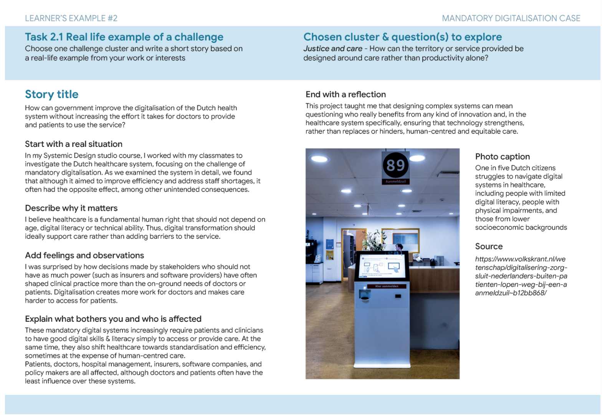

# Case: From biodiversity ambitions to local action in Zuid-Holland

Three neighborhood initiatives spanning the major urban areas of The Hague and Rotterdam and the smaller area of Rijswijk.

By Hanneke Bezemer, Axel Birnage, Amila In, Fatima-Zahra Abou Eddahab-Burke & Juliette Cortes-Arevalo

Under preparation

  
Is investing in biodiversity enough without investing in collaboration?

  
Municipalities can strengthen biodiversity by prioritising places where ecological and community values are aligned. However, lasting impact depends as much on supporting collaboration as on ecological interventions.

  
Across the neighborhood initiatives outlined in this case, participants valued diverse expertise but called for stronger evaluation, monitoring, and connections between initiatives to capture learning, broaden participation, and better support biodiversity improvements.

  
Keywords

  

    Cluster challenge:
  Vulnerability and climate adaptation  
  

  

    Method category:
    Reconstruct & Intervene
  

  

    Inner Development Goal:
    Relating - Connectedeness
  

  

    Change step:
    2. Join forces with intiatives that inspire you  
  

# Setting: Case location and documentation

Biodiversity in Dutch cities, particularly in the densely populated province of South Holland, is declining as urban development and infrastructure continue to fragment the green spaces needed for species to thrive. Yet healthy urban ecosystems can provide cultural benefits such as recreation and community cohesion while also supporting climate adaptation, depending on how they are designed and managed.

To restore and strengthen urban biodiversity, municipalities increasingly invest in neighborhood-based initiatives that engage residents, community organisations, and private actors in environmental stewardship. Such initiatives not only enhance local ecosystems but can also strengthen connections between people and nature. This case explores three initiatives (Figure Case 1-1) located in the major cities of The Hague and Rotterdam and the smaller city of Rijswijk. Their experiences offer inspiration and practical insights for anyone interested in supporting biodiversity through local collective action.

To better understand how to support neighborhood initiatives, the municipalities where these initiatives take place partnered with The Green Village, a field lab under the TU Delft’s Innovation & Impact Centre that connects practitioners and researchers working on climate adaptation innovations. Three bachelor’s theses from TU Delft’s Faculty of Technology, Policy and Management contributed to this effort by examining the strengths and tensions of municipal-community collaborations.

Drawing on policy documents, each thesis compared municipal ambitions with the experiences reported by four initiative participants interviewed between December 2025 and January 2026 to outline key lessons for similar initiatives.

## What does a multispecies approach mean for the design of cities?
When we think about communities, we often think about cities. We tend to see them as spaces made by and for people. However, cities are also shaped by other species such as plants, animals, fungi, and bacteria, as well as by many physical and digital artefacts. Together, these human and non-human actors continuously influence and shape everyday urban life. Still, in much of the Western world, cities have long been imagined as human-made and human-oriented. Plants, animals and other non-human beings were deliberately kept out of social and political life (Escobar, 2019). Ecosystems are so far valued primarily for the services they provide to people, with little consideration for the capacity of other species and ecological systems to regenerate and strengthen the relationships that enable humans and non-human forms of life to flourish together.

The result is that urban ecosystems have been profoundly transformed by human activity, a process called anthropization. Cities are now often inhospitable for both people and other living beings. The UN Sustainable Development Goals 11 (Sustainable Cities and Communities) and 15 (Life on Land) draw attention to this problem, which cities are primarily stems from human-centered design, which has shaped urban contexts that are often challenging to navigate particularly in terms of health and well-being.

A multispecies approach invites us to imagine cities differently. Instead of asking **"what does this space offer to people?"**, we can also ask, "**who already lives here, and what do they need?"**. Streets, parks and buildings become shared habitats rather than human-only places. In recent years, designers, planners and policymakers have started to explore this path. Ideas such as the "**Multispecies city"** (Houston, 2019) and the "**More-than-human city"** (Franklin, 2017; Heitlinger et al., 2024) offer new ways of thinking about coexistence, giving importance to the wellbeing and agency of human and non-human beings. Within this context, plants play a crucial role in sustaining urban ecosystems as they provide environmental, social and economic benefits for people. Yet they are still often seen as "**ontologically inferior"** to humans (Gibson & Baylee, 2018), as if they mattered less because of what they are. Design has long reduced them to resources serving human needs (Sandler, 2018; Turner-Skoff & Cavender, 2019; Višak, 2018). "**Critical Plant Studies"**, a field bringing together environmental humanities, plant sciences, art, philosophy and ethics, questions the idea of plants as passive and voiceless (Plumwood, 2002). It sees them as active agents that shape and respond to their surroundings (Marder, 2013). 

Recognising plants, and other non-human lifeforms, capable of being primary contributors in design is a challenge to reshape the role of Design today, that is overly centred on humans. This shift requires a new approach to design, fosters collaboration between multiple species as part of the solution to sustainability challenges, keeping in mind all the consequences that the act of design has for the surroundings and its actors. 

## Task 2.1 A challenge worth exploring: Your story behind it.

By Juliette-Cortes-Arevalo, Francesco Vergani & Valentina Faccoetti 

Choose a real-life challenge from the clusters listed below to explore how your personal experiences shape your connection to the challenge.

  <ul>
  <li>15 minutes own story.</li>
  <li>15 minutes to interview other actors.</li>
  </ul>

Analyse how your experiences shape your perspective on a real-world challenge and its stakeholders.

<ul>
    <li>A space to take notes and reflect.</li>
</ul>

  
Keywords

  

    Method category:
  Reconstruct & Intervene
  Reflective storytelling
  Challenge-based learning
  

  

    Inner Development Goal:
    Being - Self-awareness
  

  

    Change step:
    Connect and defining the problem  
  

This task builds on your current understanding of the challenge. Other perspectives may not yet be visible unless they are explored further, for example by using the same questions to engage with or interview other actors.

<ul><li><strong>Choose a challenge:</strong> Use the guiding questions of one challenge cluster to explore it in relation with your work or interests.</li>

::::{grid} 2
:::{card} Shared spaces and collective practices
**Who creates and governs these in the future?**

Shared spaces are increasingly shaped by tensions between shared resources and privatisation.

**Questions to explore**
- How can new shared spaces be created?
- What forms of governance can involve citizens?
:::

:::{card} Justice and care
**Who has access to wellbeing?**

Access to health, green space, mobility and safety varies.

**Questions to explore**
- How can territorial inequalities be reduced?
- How can overlooked needs become visible?
:::

:::{card} Vulnerability and climate adaptation:
**How can we live with a changing climate?**

Places, in for example, cities will face increasing exposure to extreme weather events, resource scarcity and biodiversity loss. Adaptation is not only a technical challenge but also requires new ways of inhabiting and relating to an environment.

**Questions to explore**
- How can one respond to extreme weather and new forms of vulnerability or exposure to harm or risk? 
- How can disrupted ecological relationships be restored?
- How can natural and built systems be better integrated?
- How can territories address the challenge without increasing inequalities? 
:::

:::{card} Memory and conflict:
**Whose stories shape  transformation?**

Regeneration is the process of improving and transforming parts of a place to make them stable locations to live and work. However, it often creates tensions between memories, identities, interests, and different visions of the future, where some stories are highlighted while others are overlooked or erased.

**Questions to explore**
- How can marginalised histories be recognised and valued?  
- How can conflicts between long-term residents and newcomers be addressed? 
- How can development avoid pushing aside people’s culture or stories? 
- How can conflict support transformation?
:::

:::{card} The right to transform:
**Who has the power to shape the future of a place?**

Urban transformation is often driven by a limited number of government and economic actors. Yet emerging forms of participation, activism and civic engagement are reshaping who has the power to envision, influence, and shape the future of cities.

**Questions to explore**
- Who is excluded from decisions about the future of a place?  
- How can participation be broadened and made more meaningful? 
- Which non-human actors should have a voice in decision-making? 
- What new forms of democracy could emerge?
:::
::::

<ul>
<li><strong>Start with your personal connection.</strong> Describe a moment where you noticed the challenge. Be specific (e.g. “on my daily
commute…” or “in my neighbourhood…”).</li>
<li><strong>Describe why it matters?</strong> Explain why this problem is important to you and what consequences does it have for whom.</li>
<li><strong>What does it bother you about this situation?</strong> Share what feels wrong, unfair, or unsustainable.</li>
<li><strong>What inspires you to act?</strong> Consider also what triggered your interest, positively.</li>
<li><strong>Who is mostly affected by this situation?</strong> Mention people, groups, or even the environment affected by this problem situation.</li>
<li><strong>What do you wish it could be different?</strong> Share your feelings and observations about the change you wish to see and why is not happening yet.</li>
<li><strong>What photos or visual helps to illustrate the situation?</strong> Acknowledge the source and copyrights as necessary.</li>
<li><strong>To conclude, formulate a problem statement following the below guidance:</strong>
"How can [choose an actor who has key resources or responsibilities to take action on the challenge right now and you wish to support]
address [define the chosen actor’s main objective]
without [define the main two unintended consequences this actor wants to avoid]</li>
</ul>

## Example

## Download worksheet
