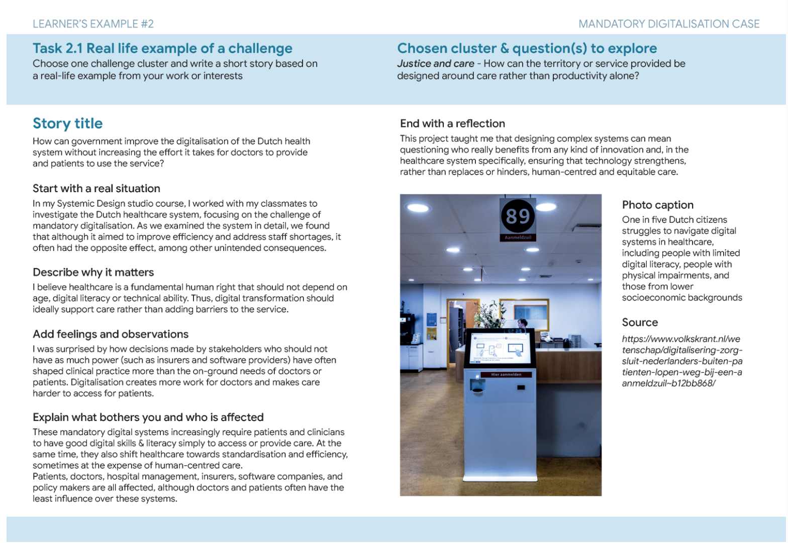

(module-4-1-beyond-human-centred-design)=

# 4.1 Beyond human-centred design

Design has always cared about the wellbeing of society (Cooper, 2011). In the 20th century, designers mostly focused their work on the design of functional objects and on testing new materials and production methods. From the 1970s onwards, the focus gradually shifted from industrial profit towards people's interests and needs. It was during this period that human-centred design emerged, an approach that begins by listening to people's needs and experiences.
By the late 1990s, design was no longer only about objects. It expanded to services, planning, community development, social innovation, and even experiments in democratic participation (Manzini, 2015). During this period, {term}`service design` became established as the practice of designing services around people's experiences. Services came to be seen as drivers of wider social change (Sangiorgi, 2011), supporting more collaborative, sustainable, and creative societies. This requires inclusive participation, where people take part in discussions and influence collective decisions.

As design engaged with increasingly complex social challenges, human-centred design evolved into community-centred design (Meroni, 2007). Rather than designing for individual users, community-centred design works with groups and communities to create innovative solutions. The focus shifts from individual needs to the collective interests, values, and aspirations shared by a community (IDEO.org, 2015).

<iframe width="560" height="315" src="https://www.youtube.com/embed/XGSynJIXB7o?si=xiJVl98IPkiwOb9U" title="YouTube video player" frameborder="0" allow="accelerometer; autoplay; clipboard-write; encrypted-media; gyroscope; picture-in-picture; web-share" referrerpolicy="strict-origin-when-cross-origin" allowfullscreen></iframe>

::::{dropdown} Video transcript
:icon: comment

What is the de-centering perspective?

So de-centering in general terms means shifting away from having a single perspective at the core of our system, that it's quite usually the one of the humans. It means acknowledging the fact that perspectives are always partial, situated and not universal. De-centering is a way for us to understand that while in the process of designing we need to care not just for the people, but also the need, the requirements of other entities that are sometimes biological entities like plants, animals and bacteria, but other time non-human entities such as artificial intelligence and machine learning. De-centering doesn't mean putting away the perspective of the human, but creating spaces for other perspectives. As for transdisciplinary learning, de-centering perspectives might be able to open up to a form of knowledge that it's ecological, it's experiential, might be indigenous and not just fixed into an anthropocentric and human body.s

::::

## Task 2.1 A challenge worth exploring: Your story behind it.

By Juliette-Cortes-Arevalo, Francesco Vergani & Valentina Faccoetti 

Choose a real-life challenge from the clusters listed below to explore how your personal experiences shape your connection to the challenge.

  <ul>
  <li>15 minutes own story.</li>
  <li>15 minutes to interview other actors.</li>
  </ul>

Analyse how your experiences shape your perspective on a real-world challenge and its stakeholders.

<ul>
    <li>A space to take notes and reflect.</li>
</ul>

  
Keywords

  

    Method category:
  Reconstruct & Intervene
  Reflective storytelling
  Challenge-based learning
  

  

    Inner Development Goal:
    Being - Self-awareness
  

  

    Change step:
    Connect and defining the problem  
  

This task builds on your current understanding of the challenge. Other perspectives may not yet be visible unless they are explored further, for example by using the same questions to engage with or interview other actors.

<ul><li><strong>Choose a challenge:</strong> Use the guiding questions of one challenge cluster to explore it in relation with your work or interests.</li>

::::{grid} 2
:::{card} Shared spaces and collective practices
**Who creates and governs these in the future?**

Shared spaces are increasingly shaped by tensions between shared resources and privatisation.

**Questions to explore**
- How can new shared spaces be created?
- What forms of governance can involve citizens?
:::

:::{card} Justice and care
**Who has access to wellbeing?**

Access to health, green space, mobility and safety varies.

**Questions to explore**
- How can territorial inequalities be reduced?
- How can overlooked needs become visible?
:::

:::{card} Vulnerability and climate adaptation:
**How can we live with a changing climate?**

Places, in for example, cities will face increasing exposure to extreme weather events, resource scarcity and biodiversity loss. Adaptation is not only a technical challenge but also requires new ways of inhabiting and relating to an environment.

**Questions to explore**
- How can one respond to extreme weather and new forms of vulnerability or exposure to harm or risk? 
- How can disrupted ecological relationships be restored?
- How can natural and built systems be better integrated?
- How can territories address the challenge without increasing inequalities? 
:::

:::{card} Memory and conflict:
**Whose stories shape  transformation?**

Regeneration is the process of improving and transforming parts of a place to make them stable locations to live and work. However, it often creates tensions between memories, identities, interests, and different visions of the future, where some stories are highlighted while others are overlooked or erased.

**Questions to explore**
- How can marginalised histories be recognised and valued?  
- How can conflicts between long-term residents and newcomers be addressed? 
- How can development avoid pushing aside people’s culture or stories? 
- How can conflict support transformation?
:::

:::{card} The right to transform:
**Who has the power to shape the future of a place?**

Urban transformation is often driven by a limited number of government and economic actors. Yet emerging forms of participation, activism and civic engagement are reshaping who has the power to envision, influence, and shape the future of cities.

**Questions to explore**
- Who is excluded from decisions about the future of a place?  
- How can participation be broadened and made more meaningful? 
- Which non-human actors should have a voice in decision-making? 
- What new forms of democracy could emerge?
:::
::::

<ul>
<li><strong>Start with your personal connection.</strong> Describe a moment where you noticed the challenge. Be specific (e.g. “on my daily
commute…” or “in my neighbourhood…”).</li>
<li><strong>Describe why it matters?</strong> Explain why this problem is important to you and what consequences does it have for whom.</li>
<li><strong>What does it bother you about this situation?</strong> Share what feels wrong, unfair, or unsustainable.</li>
<li><strong>What inspires you to act?</strong> Consider also what triggered your interest, positively.</li>
<li><strong>Who is mostly affected by this situation?</strong> Mention people, groups, or even the environment affected by this problem situation.</li>
<li><strong>What do you wish it could be different?</strong> Share your feelings and observations about the change you wish to see and why is not happening yet.</li>
<li><strong>What photos or visual helps to illustrate the situation?</strong> Acknowledge the source and copyrights as necessary.</li>
<li><strong>To conclude, formulate a problem statement following the below guidance:</strong>
"How can [choose an actor who has key resources or responsibilities to take action on the challenge right now and you wish to support]
address [define the chosen actor’s main objective]
without [define the main two unintended consequences this actor wants to avoid]</li>
</ul>

## Example

## Download worksheet
